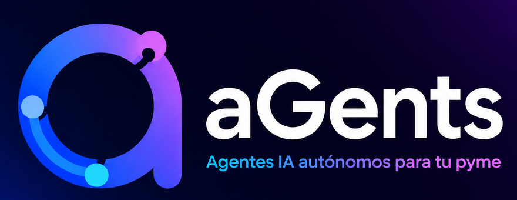

<p align="center"></p>

# aGents

**Una oficina de agentes de inteligencia artificial para tu pyme, instalada en tu propia computadora.**

aGents te ayuda a saber cómo está tu negocio, qué atender primero y cómo crecer. Le respondes un diagnóstico guiado y te entrega un semáforo por área, un plan con fechas y un equipo de agentes (Finanzas, Ventas, Marketing, Recursos humanos y más) al que le puedes pedir trabajo como a un equipo de oficina.

Es gratis, de código abierto y funciona en Windows y Mac. Tus datos se quedan en tu computadora: no hay cuentas, registros ni servidores de nadie.

**Ir a:** [Qué hace](#qué-hace) · [Por qué te ayuda](#por-qué-te-ayuda) · [Instalación paso a paso](#instalación-paso-a-paso) · [Activar la IA](#activar-la-ia-opcional) · [Todo lo que incluye](#qué-incluye)

---

## Qué hace

- **Diagnostica tu negocio en unos 15 minutos.** Respondes preguntas sencillas sobre ventas, dinero, personal, operación y clientes, y obtienes un semáforo (verde, amarillo, rojo) por cada área.
- **Te dice qué atender primero.** Detecta contradicciones entre áreas (por ejemplo, gastar en publicidad con la caja en rojo) y arma un plan de acción a 30 y 60 días con responsables.
- **Pone un equipo de agentes a tu servicio.** Escribes lo que necesitas sin elegir a quién; la oficina decide qué agente lo atiende. Los agentes se consultan entre sí, piden presupuesto y te entregan una sola respuesta.
- **Lleva el control de la semana.** Junta semanal con compromisos, flujo de caja a 13 semanas, presupuesto por área, bitácora de acciones y avisos de lo que se venció.
- **Hace cuentas y documentos.** Calculadora laboral con la Ley Federal del Trabajo (aguinaldo, finiquito, vacaciones, PTU), reportes en Word y PDF, campañas con los tamaños de cada red social y calendario exportable.
- **Se adapta a tu giro.** Comercio, servicios, manufactura, construcción, alimentos, salud, educación y agencias; con una agenda de citas opcional para consultorios y negocios que atienden con cita.

Todo lo anterior, menos las respuestas de los agentes, funciona **sin inteligencia artificial y sin internet**. La IA es opcional: se activa con tu propia clave de Anthropic u OpenAI, y la aplicación te muestra el costo en pesos antes de gastar.

## Por qué te ayuda

| Si hoy te pasa esto… | aGents te da… |
|---|---|
| No sabes por dónde empezar a ordenar el negocio | Un diagnóstico con prioridades claras y un plan con fechas |
| Todo depende de ti y no te alcanza el tiempo | Agentes que preparan análisis, propuestas, mensajes y cálculos para que tú solo decidas |
| No puedes pagar un consultor para cada área | Once áreas de negocio con sus especialistas, disponibles cuando las necesites |
| Te preocupa subir tu información a internet | Una aplicación que guarda todo en tu computadora y que puedes respaldar con un botón |
| Temes que la IA gaste sin control | Costo en pesos a la vista, límite mensual y nada que arranque solo: los agentes proponen y tú apruebas |

También le sirve a **consultores y contadores** que acompañan a sus clientes (reportes, calculadora laboral, informe del Coordinador) y a **desarrolladores** que quieran adaptarla: es un proyecto Node.js sin dependencias, con 262 pruebas y agentes definidos en texto.

> Las reglas y las respuestas de los agentes son una guía para decidir mejor. No sustituyen a tu contador, abogado o consultor.

## Instalación paso a paso

No necesitas saber de programación. Son tres pasos y toman unos 10 minutos. Solo se hace una vez.

### En Windows

**Paso 1. Instala Node.js** (el programa que hace funcionar a aGents; es gratuito).

1. Entra a [nodejs.org](https://nodejs.org/es) y pulsa el botón de descarga de la versión **LTS**.
2. Abre el archivo descargado y pulsa **Siguiente** en todas las pantallas hasta terminar. No cambies ninguna opción.

**Paso 2. Descarga aGents.**

1. Descarga este archivo: [aGents (ZIP)](https://github.com/JonathanSerralde/aGents/archive/refs/heads/main.zip).
2. Ve a tu carpeta **Descargas**, haz clic derecho sobre `aGents-main.zip` y elige **Extraer todo**.
3. Mueve la carpeta `aGents-main` a un lugar que recuerdes, por ejemplo **Documentos**.

**Paso 3. Abre aGents.**

1. Entra a la carpeta `aGents-main` hasta que veas dentro las carpetas `src` y `public`.
2. Haz clic en la barra de direcciones de la ventana (donde aparece la ruta de la carpeta), escribe `cmd` y presiona **Enter**. Se abre una ventana negra.
3. En esa ventana escribe `npm start` y presiona **Enter**.
4. Cuando aparezca el texto `aGents en http://127.0.0.1:4791`, abre tu navegador (Chrome, Edge o el que uses) y entra a **http://127.0.0.1:4791**.

Deja la ventana negra abierta mientras uses aGents.

### En Mac

**Paso 1. Instala Node.js** (el programa que hace funcionar a aGents; es gratuito).

1. Entra a [nodejs.org](https://nodejs.org/es) y pulsa el botón de descarga de la versión **LTS**.
2. Abre el archivo descargado y pulsa **Continuar** en todas las pantallas hasta terminar.

**Paso 2. Descarga aGents.**

1. Descarga este archivo: [aGents (ZIP)](https://github.com/JonathanSerralde/aGents/archive/refs/heads/main.zip).
2. Ve a tu carpeta **Descargas**. Si la carpeta `aGents-main` no aparece sola, haz doble clic en `aGents-main.zip`.
3. Mueve la carpeta `aGents-main` a un lugar que recuerdes, por ejemplo **Documentos**.

**Paso 3. Abre aGents.**

1. Abre la aplicación **Terminal**: presiona `Cmd + Espacio`, escribe `Terminal` y presiona **Enter**.
2. Escribe `cd` seguido de un espacio, arrastra la carpeta `aGents-main` a la ventana de Terminal y presiona **Enter**.
3. Escribe `npm start` y presiona **Enter**.
4. Cuando aparezca el texto `aGents en http://127.0.0.1:4791`, abre tu navegador (Safari, Chrome o el que uses) y entra a **http://127.0.0.1:4791**.

Deja la ventana de Terminal abierta mientras uses aGents.

### Tu primera vez dentro

- Si solo quieres conocerla, pulsa **Ver un negocio de ejemplo**: carga una empresa inventada para que explores sin capturar nada. Se borra cuando quieras.
- Para empezar con tu negocio, llena el **diagnóstico**. Al terminar verás tu semáforo, tu plan y tu equipo de agentes.

### Uso diario

- **Abrir:** repite solo el paso 3. Los pasos 1 y 2 ya no hacen falta.
- **Cerrar:** cierra la ventana negra (Windows) o la de Terminal (Mac). También puedes presionar `Ctrl + C` dentro de ella.
- **Tus datos** viven en la carpeta `data`, dentro de `aGents-main`. No la borres. Para respaldarlos usa el botón de respaldo en **Configuración**.
- **Actualizar a una versión nueva:** descarga otra vez el ZIP, extráelo y copia tu carpeta `data` de la carpeta anterior a la nueva.

### Si algo no funciona

| Lo que ves | Qué hacer |
|---|---|
| `"npm" no se reconoce` o `command not found: npm` | Node.js no quedó instalado o falta reiniciar. Cierra la ventana, reinicia la computadora y repite el paso 3. Si sigue igual, repite el paso 1. |
| `Could not read package.json` o un error parecido | La ventana no está en la carpeta correcta. Entra a la carpeta donde se ven `src` y `public` y repite el paso 3. |
| El navegador dice que no puede conectarse | Revisa que la ventana negra o la Terminal sigan abiertas y que muestren `aGents en http://127.0.0.1:4791`. |
| `aGents ya está en ejecución` | Ya está abierta en otra ventana. Entra directo a http://127.0.0.1:4791 en tu navegador. |

### Para desarrolladores

Node.js 18 o superior. Sin dependencias: `npm install` no hace falta.

```bash
git clone https://github.com/JonathanSerralde/aGents.git
cd aGents
npm start          # http://127.0.0.1:4791
npm test           # 262 pruebas; escriben en carpetas temporales, nunca en data/
```

Una instalación recién clonada empieza vacía: `data/` se crea al primer uso y git la ignora. Para actualizar, `git pull`.

## Activar la IA (opcional)

Sin este paso aGents ya funciona: diagnóstico, semáforo, plan, junta semanal, flujo de caja, calculadora laboral y reportes. Lo que falta son **las respuestas de los agentes**. Para que los agentes respondan y trabajen necesitas una clave de API de Anthropic (la empresa que hace Claude). Se configura una sola vez y toma unos 10 minutos.

> Una clave de API **no es lo mismo** que una suscripción de Claude (Pro o Max). La suscripción no sirve aquí. La clave se paga aparte, por uso: solo pagas lo que los agentes consumen.

**Paso 1. Crea tu cuenta de Anthropic.**

1. Entra a [console.anthropic.com](https://console.anthropic.com) y regístrate con tu correo.
2. Completa los datos que te pida (nombre y, si quieres, el de tu negocio).

**Paso 2. Agrega saldo.**

1. Dentro de la consola, entra a **Billing** (Facturación).
2. Agrega una tarjeta y compra saldo. Con el mínimo (5 dólares) alcanza para probar con calma.
3. Recomendado: deja apagada la recarga automática mientras conoces cuánto gastas.

**Paso 3. Crea tu clave.**

1. En la consola, entra a **API Keys** y pulsa **Create Key**.
2. Ponle un nombre, por ejemplo `aGents`.
3. Copia la clave que aparece: empieza con `sk-ant-`. **Solo se muestra una vez**; si la pierdes, crea otra.

**Paso 4. Pégala en aGents.**

1. Abre aGents y entra a **Configuración** (en el menú de la izquierda).
2. En **Inteligencia artificial**, elige **Anthropic** como proveedor.
3. Pega tu clave en **Clave de API de Anthropic**.
4. Pulsa **Probar conexión**. Si responde bien, pulsa **Guardar**.

**Paso 5. Ponle un tope a tu gasto.**

En la misma pantalla, escribe una cantidad en **Tope de gasto al mes, en pesos**. Al llegar a esa cantidad, los agentes se detienen hasta que tú lo autorices. aGents te muestra el costo estimado en pesos antes de cada acción y lo que llevas gastado en el mes.

Listo: entra a **Agentes**, o escribe lo que necesitas en **Pide lo que necesites**, y tu equipo empieza a responder.

**Lo que debes saber sobre tu clave**

- Se guarda solo en tu computadora (en `data/config.json`) y en pantalla se muestra oculta. No se envía a nadie más que a Anthropic, para obtener las respuestas.
- Trátala como una contraseña: no la compartas ni la pegues en chats o correos. Quien la tenga puede gastar tu saldo.
- Si crees que alguien más la vio, bórrala en la consola de Anthropic (**API Keys**) y crea una nueva.
- Para quitarla de aGents: **Configuración › Quitar claves**.
- Nada que gaste IA arranca solo: las tareas automáticas vienen apagadas y tú decides cuáles encender.

**Si la prueba de conexión falla**

| Lo que pasa | Qué hacer |
|---|---|
| Clave inválida o no autorizada | Cópiala de nuevo completa, sin espacios al inicio ni al final. Si no la tienes, crea otra. |
| Saldo insuficiente | Agrega saldo en **Billing** dentro de la consola de Anthropic. |
| No hay conexión | Revisa tu internet. Los agentes necesitan internet para responder; el resto de aGents no. |

También puedes usar una clave de OpenAI eligiendo ese proveedor en la misma pantalla; las herramientas locales de los agentes (calculadora laboral, presupuesto, flujo de caja y búsqueda en tus documentos) solo funcionan con Anthropic.

Para desarrolladores: como alternativa, copia `.env.example` a `.env`. Recomendaciones de costo: modo de ahorro *Equilibrado* (tu chat con el modelo principal; lo automático con `claude-haiku-5-5`), piloto por lotes encendido y límite diario de tokens. Cada búsqueda web se cobra aparte en la cuenta del proveedor.

## Principios (no negociables)

- **Todo local.** El servidor solo escucha en `127.0.0.1`; los datos viven en `data/` junto a la aplicación y nunca se versionan ni se envían a nadie.
- **Sin cuentas, sin login, sin telemetría.** Una instalación es un negocio.
- **IA opcional y con tu clave.** Solo Anthropic u OpenAI con la clave del propio usuario (nunca sesiones de suscripción de Claude o ChatGPT: sus términos no lo permiten). Sin clave, nada sale de la computadora.
- **Los agentes proponen, el dueño decide.** Ninguna idea se aprueba, ningún agente se crea ni se gasta dinero sin que la persona lo acepte.
- **Transparencia.** Lo que hacen los agentes (búsquedas, consultas, encargos, piloto) queda registrado y a la vista; los permisos se controlan desde el dashboard.

## Qué incluye

### Diagnóstico y motor de reglas (sin IA)
- Asistente guiado por pasos con identidad, logotipo y equipo; bloque específico por giro: comercio, servicios, manufactura, construcción, alimentos, agencia de marketing, educación y salud.
- Semáforo por área (verde/amarillo/rojo), **reglas cruzadas** que detectan contradicciones entre áreas (gastar en captación con la caja en rojo, expandirse dependiendo del dueño…), prioridad ponderada, plan de acción a 30/60 días y motor de crecimiento vertical/horizontal.
- Reportes en Word (.docx, generados sin dependencias) y página imprimible para PDF.
- **Informe del Coordinador** por reglas: estado, contradicciones, acciones vencidas, mercado, sitio y siguiente paso.
- **Calculadora laboral** (Ley Federal del Trabajo): aguinaldo, vacaciones y prima, finiquito, liquidación, PTU, fondo de ahorro, vales, descuento INFONAVIT y listas de alta/baja.
- **Análisis del sitio web** del negocio: HTTPS, encabezados de seguridad, versión móvil, botón de WhatsApp, aviso de privacidad, medición, velocidad.
- Campañas: piezas con los tamaños correctos de Meta, TikTok, Google/YouTube, LinkedIn, WhatsApp, X y Pinterest.
- Calendario `.ics`: exporta las fechas de la oficina a Google/Outlook/Apple e importa tu agenda.

### Agentes (con IA, usando tu clave)
- **11 agentes de área**: Dirección, Finanzas, Ventas, Marketing, Compras, Operaciones, Recursos humanos, Tecnología, Fiscal y legal, Riesgos, Crecimiento.
- **Staff del Coordinador**: Analista, Planificador, Brainstorm y creatividad, Descubrimiento de ideas, Gestión ágil de proyectos, Auditoría, Contraloría.
- **Subagentes por área**: Contabilidad, Crédito y cobranza, Análisis de inversiones, Venta en línea, Atención a clientes, Tráfico digital, Investigación de mercado, Imagen y exhibición, Operación de tienda, Producción y calidad, Mantenimiento, Inventarios y almacén, Logística e importaciones, Mejora continua, Capacitación, Reclutamiento, Nómina y seguridad social, Transformación digital, Ciberseguridad, Jurídico, Expansión y aperturas, Prevención de pérdidas, Administración de oficina.
- **Opcionales por sector** (se activan solos según el giro): Alimentos y bebidas, Cuentas de agencia, Control escolar, Admisiones, Operación clínica.
- Hasta 20 **agentes propios** creados por el usuario, y subagentes que el Coordinador propone cuando detecta una necesidad.
- Cada agente tiene su **skill** (rol, especialidad, preguntas que hace primero, marcos, acciones, límites, indicadores) con especificidad mexicana (CFDI, IMSS, LFT, Profeco, COFEPRIS, RVOE…) y **ajustes por negocio**.

### Cómo trabajan juntos
- **Jerarquía con efecto real**: quién reporta a quién decide quién puede delegar.
- **Comunicación entre agentes**: `CONSULTAR`, `DELEGAR`, `INFORMAR`, con segunda vuelta y presupuesto de llamadas por orden.
- **Memoria compartida (bitácora)**: acciones con plazo y vencimiento, **hechos** de la empresa, **ideas** en evaluación y glosario de **conceptos**. Un clasificador distingue si lo que escribes es un dato real, una idea o una pregunta, y el agente responde en consecuencia.
- **Investigación semanal de mercado**: al menos 10 competidores y 5 comentarios positivos y negativos de clientes por cada uno (búsqueda web del proveedor), repartida a Ventas, Marketing y a quien aluda cada queja.
- **Piloto automático**: cada agente tiene su revisión periódica (Finanzas revisa caja y cobranza, Fiscal el calendario del mes, Ventas la oferta de la semana, el Coordinador reparte lo que detecte) y la hace solo, coordinándose con los demás. Apagado hasta que el usuario lo enciende.
- **Rutinas**: si repites una orden tres veces, la oficina te ofrece automatizarla.
- Ingesta de documentos (Word, PDF con texto, imágenes con IA), bóvedas de notas Obsidian u otras carpetas Markdown, ficha completa de la empresa.

### Equipo con presupuesto y aprobación del dueño
- **Cadena de dos pasos:** el agente que recibe un encargo o una consulta puede hacer una consulta más (Dirección → Marketing → Finanzas), con tope de seis llamadas por orden.
- **Segunda vuelta** (`concluirOrden` en `src/server.js`): en las órdenes del dueño, quien preguntó recibe las respuestas y entrega una sola propuesta ya ajustada; las respuestas de los demás quedan debajo. Lo automático (piloto y rutinas) no hace segunda vuelta.
- **Presupuesto por área** (`src/presupuesto.js`, Configuración › Presupuesto del mes): el dueño captura cuánto puede gastar cada área al mes; entra al contexto de todos los agentes con lo ya aprobado y lo disponible.
- **Gastos por aprobar:** cuando una propuesta cuesta dinero, el agente escribe `GASTO: [área] — concepto — monto`. Queda pendiente en la portada con lo que significaría para el presupuesto; el dueño aprueba o rechaza y la decisión queda como hecho del área. La aplicación no compra ni paga nada.

### Memoria que no encarece con el tiempo
- **Archivo de memoria** (`src/archivo.js`, `data/memoria-archivo.json`): guarda todo lo que la oficina aprende, tipado (hecho, decisión, conclusión, acción cumplida, idea, concepto), hasta 20,000 entradas. No viaja completo a la IA.
- **Lo que sí viaja en cada orden:** lo que el dueño fijó (máximo 12), hasta seis entradas relacionadas con la orden (búsqueda por palabras y sinónimos de negocio, sin IA), lo más reciente y las últimas conclusiones del área; todo en un bloque de 2,200 caracteres como máximo.
- **Historial recortado:** de la conversación con cada agente, los últimos cuatro mensajes van completos y los anteriores se reducen a su inicio.
- **Buscador para el dueño** (Agentes › Bitácora › Archivo de memoria, `/api/archivo`): buscar, fijar, soltar y borrar. En Configuración › Consumo de IA se ve cuánto contexto carga cada agente (`/api/contexto`).
- La búsqueda es por palabras, no por significado: buscar por significado pediría un modelo local o enviar todo al proveedor.

### Agenda de citas y clientes (módulo opcional)
- **Para cualquier negocio que atiende con cita** (`src/agenda.js`, `data/agenda.json`): se enciende en Configuración › Módulos opcionales y entonces aparece "Agenda" en el menú. Apagada no ocupa nada y no borra datos. El dueño elige cómo llama a quienes atiende: clientes, pacientes, alumnos o huéspedes.
- **Qué lleva:** citas por semana con duración, servicio, quién atiende, precio y estado (programada, confirmada, asistió, no asistió, cancelada); aviso de horarios encimados; personas con visitas, faltas y adeudo; recordatorio por WhatsApp que envía el dueño.
- **Privacidad:** nombres, teléfonos y notas se quedan en el equipo. A los agentes solo les llegan cifras agregadas. No es un expediente clínico ni una agenda en línea.

### Habilidades parejas y contexto a la medida
- **Las 47 habilidades tienen la misma forma** (`src/habilidades.js` + `src/habilidades-extra.js`): cuándo usar al agente, qué entrega, en quién se apoya (dos o tres agentes siempre activos) y qué indicadores vigila. Las más cortas se reforzaron con marcos y acciones.
- **Consulta entre agentes en modo compacto:** reglas cortas (150 palabras, sin formatos de secciones, gastos ni estado) y habilidad resumida. El contexto de una consulta baja cerca de la mitad.
- **Referencias de México por tema:** un agente con varios bloques (laboral, fiscal, financiamiento, mercado, digital) recibe solo los que tocan la orden, y viajan en la parte que cambia para no romper la caché del proveedor.
- **Medido con el negocio de ejemplo:** la cadena Coordinador → Marketing → Finanzas → cierre pasó de 17,678 a 12,957 tokens de contexto; una orden al Coordinador, de 6,462 a 5,106.

### Calidad de los agentes, medida
- **Prueba con IA real** (`src/calidad.js`, Agentes › Ajustes › Calidad): el dueño elige hasta cuatro agentes; cada uno recibe seis órdenes típicas y sus respuestas se revisan con reglas (usa su habilidad, respeta sus límites, da acciones con responsable y plazo, propone el gasto en formato). Muestra el costo antes, gasta de la clave del dueño y no toca conversaciones ni memoria.
- **Voto del dueño:** "Sirvió / No sirvió" bajo cada respuesta; el resumen por agente indica cuál conviene revisar.
- **Cifras reales para los agentes** (interruptor en Configuración › Datos reales, apagado de fábrica): totales y porcentajes de las facturas y del flujo de caja, nunca nombres de clientes ni proveedores.
- **Avisos sin IA** (`src/alertas.js`): caja en rojo, cobranza vencida, presupuesto agotado, gastos sin decidir, acciones vencidas y citas. Cada aviso abre el chat del agente con la orden escrita; la IA solo se usa si el dueño la envía.
- **Resultado de las acciones:** al marcar una acción como hecha se pregunta qué resultado tuvo; queda en el archivo de memoria y le llega al agente del área.
- **Conclusiones útiles:** lo que se guarda de cada respuesta es la propuesta, no el eco de "Entendí que…".
- **Habilidad visible y editable** (Agentes › Ajustes): se ve completa y se pueden apagar marcos y acciones por negocio; los límites están protegidos.
- **Modelo según la tarea:** un modelo mayor opcional para los agentes que el dueño elija, solo en sus órdenes directas y con su costo a la vista.

### Flujo de trabajo entre agentes
- **Encadenado:** orden → respuesta del agente → consultas y encargos → versión final ajustada → revisión → entrega.
- **En paralelo** (`colaborar` en `src/colaboracion.js`): los encargos y consultas de una orden se atienden hasta tres a la vez; la espera es la del más lento. El consumo se anota al agente que respondió en la propia llamada, no en una variable compartida.
- **Revisión antes de entregar** (evaluador y corrector, `revisarAntesDeEntregar`): las reglas revisan sin costo si un gasto no cabe en el presupuesto, si una acción no trae responsable y plazo o si hay demasiadas preguntas; los agentes con modelo mayor pasan además por un revisor con el modelo económico. Solo si hay algo que corregir se pide una versión nueva. Se apaga en Configuración › IA.

### Entrada única, documentos del negocio y herramientas
- **Entrada única** (`src/ruteo.js`, portada › "Pide lo que necesites"): el dueño escribe sin elegir agente y la oficina decide con reglas, sin IA, quién lo atiende comparando la orden con el vocabulario de cada habilidad. Las prioridades y lo que cruza áreas van al Coordinador. Antes de enviar se ve a quién le llega y cuánto cuesta, y se puede elegir otro.
- **Documentos del negocio (RAG):** los documentos subidos se buscan por fragmentos (`buscarEnDocumentos`) y los que tocan la orden entran al contexto con su fuente, igual que las carpetas de notas. Es independiente de la memoria: la memoria guarda lo que la oficina aprendió; esto, lo que el negocio ya tenía escrito.
- **Herramientas locales** (`src/herramientas.js`, uso de herramientas de la API de Anthropic): en las órdenes del dueño el agente puede pedir la calculadora laboral, el presupuesto, el flujo de caja (solo si el dueño compartió sus cifras) y búsquedas en la memoria y en los documentos. Corren en este equipo, hasta tres por orden, y se apagan en Configuración › IA. Con OpenAI no se usan.

### Tareas automáticas que sí arrancan, y solo las que el usuario enciende
- Un agente del piloto o una tarea semanal sin configuración propia cuenta desde que se encendió (`_encendido` en `data/piloto.json`, `_inicio` en `data/programacion.json`), no desde "ahora" en cada lectura. Antes su próxima corrida siempre quedaba en el futuro y no corría nunca.
- El piloto sigue apagado de fábrica. Al encenderlo, cada agente hace su primera revisión en su próximo día y hora, no de inmediato.
- La investigación semanal de mercado (gasta IA y búsquedas) empieza en pausa hasta que el usuario la active; una investigación hecha a mano ya no la enciende. El análisis semanal del sitio (sin IA) corre solo.
- Reactivar una tarea que estuvo en pausa cuenta desde ese momento: no dispara la corrida "atrasada".

### Para cualquier industria
- **16 giros** en el diagnóstico: comercio, servicios profesionales, manufactura, construcción, alimentos, agencia, educación, salud, transporte y logística, tecnología y software, hospedaje y turismo, agropecuario, servicios personales, automotriz, inmobiliario y otro.
- **Cada giro tiene su contexto de sector** (`src/sectores.js`): indicadores de referencia, cumplimiento en México y qué hunde o hace crecer a ese tipo de negocio. Llega al prompt de todos los agentes. Los rangos son referencias generales, no cifras oficiales.
- **Preguntas de profundidad por giro** (Bloque B en `src/formulario.js`, reglas en `src/diagnostico.js`): dos indicadores que el dueño conoce de memoria por cada giro, con umbrales que pintan el semáforo y proponen la acción.

### Diagnóstico exprés
- El asistente ofrece dos caminos: **exprés** (22 preguntas esenciales en cuatro pasos, unos cinco minutos, para cualquier giro) y **completo** (todas las áreas más las preguntas del giro). El exprés da un primer semáforo y plan; al actualizar, el completo ya trae lleno lo contestado. La lista de preguntas esenciales vive en `CAMPOS_EXPRES` (`public/app.js`); el servidor no cambia, porque el motor ya tolera respuestas parciales.

### Avance medible
- **Tu avance** (`src/progreso.js`, `GET /api/progreso`): compara el diagnóstico en pantalla con uno anterior y dice, con reglas y sin IA, cuánto cambió la madurez, qué áreas mejoraron o empeoraron y qué acciones del plan anterior ya no hacen falta. Incluye la línea de madurez de todos los diagnósticos guardados y un selector para elegir contra cuál comparar. El Informe del Coordinador (pantalla, Word y PDF) abre con ese avance.
- **Actualizar diagnóstico**: el asistente parte de las respuestas del diagnóstico anterior; el dueño solo corrige lo que cambió (o elige "Empezar en blanco").
- **Borrar diagnósticos** de prueba desde Reportes (`DELETE /api/diagnosticos/:id`), con confirmación en el mismo botón.

### Qué hacer esta semana y negocio de ejemplo
- **Esta semana** (portada): lo primero que se ve en la Ciudad son hasta tres compromisos de la junta de la semana, con responsable y fecha, para palomearlos al cumplirlos. Son los mismos de la Junta semanal; "Atender primero" ahora nombra solo tres áreas.
- **Negocio de ejemplo** (`src/demo.js`): con la instalación vacía, "Ver un negocio de ejemplo" abre una ferretería inventada ya con dos diagnósticos, facturas, flujo de caja y junta. Vive en su propia carpeta (`data/empresas/<id>/`), no usa IA y no toca tus datos; un aviso fijo permite volver a tu negocio o quitar el ejemplo. Es la única empresa que la aplicación puede eliminar.

- **Pocos agentes a la vista, sin perder ninguno:** el equipo de la portada muestra al Coordinador, las once áreas y los agentes propios. Los especialistas viven dentro de su área ("+3 especialistas") y los que no son de ninguna, en "Apoyo general". Se puede buscar por lo que saben hacer, agrupar por persona responsable o ver a todos. Cada área tiene la instrucción de usar a sus especialistas sin que el dueño lo pida.

- **Respaldo con un clic** (`src/respaldo.js`, `GET /api/respaldo`): Configuración › Respaldo descarga un .zip con los datos de todas las empresas y un LEEME con los pasos para restaurar. Excluye `config.json` (la clave de IA), se arma en el equipo y no se envía a ningún lado. La portada lo recuerda si nunca se ha hecho o si pasó un mes.

- **Avisos que resuelven:** cuando un límite detiene a la IA, un aviso fijo dice cuál fue, cuánto se lleva gastado y cuánto cuesta una orden, con botones para subirlo ahí mismo (`PUT /api/configuracion/limites` cambia solo los límites). En el aviso del semáforo, cada área movida por las facturas abre su panel con el porqué.

- **Estados vacíos con siguiente paso:** la junta sin diagnóstico ofrece empezar o ver el ejemplo; los avisos de "Sin IA configurada" traen el botón "Activar la IA"; la red de agentes y la bitácora vacías llevan al chat o a la junta.

- **Pantallas chicas y celular:** todas las vistas se acomodan sin desbordarse desde 400 px de ancho. La oficina solo escucha en esta computadora (127.0.0.1), así que no se abre desde el teléfono; para llevarse los pendientes, "Esta semana" los manda por WhatsApp (lo abre el usuario; la aplicación no envía nada) o los copia.

- **Avance sin castigo:** cuando las facturas mueven el semáforo, "Tu avance" dice qué áreas movieron y cuánto sería la madurez solo con las respuestas del dueño (`facturas` en la comparación de `src/progreso.js`).
- **Red de agentes legible:** el nombre de cada área se coloca donde menos se encima con otros nodos y nombres (`ubicarEtiquetas` en `public/red.js`).

### Junta semanal
- **Junta del lunes** (`src/junta.js`, `GET /api/junta`, vista "Junta semanal"): una hoja por semana con tres cifras (dinero y cobranza si hay facturas; madurez y áreas en atención si no), hasta tres decisiones en orden de urgencia con su motivo, y hasta tres compromisos con responsable, repartidos entre áreas. Sin IA. Los compromisos se fijan al abrir la semana y viven en la bitácora; el lunes siguiente la hoja empieza por decir cuáles se cumplieron. Se exporta a Word y PDF.
- **Compromisos editables:** el dueño agrega uno propio (con área, responsable y fecha), suma una acción abierta de la bitácora, corrige texto, responsable o fecha, o quita uno de la junta (sigue abierto en la bitácora). Máximo seis por semana.
- **Avisar al equipo sin servidores de terceros:** por cada responsable hay un mensaje ya escrito con "Enviar por WhatsApp" (abre el WhatsApp del propio usuario con `wa.me`; él elige el contacto) y "Copiar". La aplicación no envía nada por su cuenta.

### Flujo de caja a 13 semanas
- **Flujo de caja** (`src/flujo.js`, `GET/PUT /api/flujo`, tarjeta en el dashboard): proyecta semana por semana lo que entra (venta de contado promedio y cobranza de lo facturado a crédito que sigue abierto) y lo que sale (gastos de contado, nómina timbrada y pagos a proveedores), y avisa en qué semana faltaría dinero. Usa los complementos de pago para saber qué facturas siguen abiertas y cuánto tardan en pagar los clientes. El dueño captura su saldo de hoy; hay un escenario conservador. Sin IA. Los supuestos se muestran en pantalla: solo ve lo que tiene factura.
- **Carpeta vigilada:** mientras la aplicación esté abierta revisa cada diez minutos la carpeta de facturas; si hay archivos nuevos vuelve a analizarla sola y actualiza el flujo y el informe. Se puede apagar.

### Costo de la IA en pesos
- **Costo antes de actuar** (`src/precios.js`, `costos` en `GET /api/estado`): junto a cada acción que gasta IA (orden a un agente, redactar un entregable, construir una campaña, investigar el mercado, optimizar agentes, analizar un documento) aparece cuánto cuesta en pesos: un aproximado y un tope. La entrada sale del tamaño real del contexto de los agentes; la salida esperada, del promedio del mes; el tope supone la respuesta más larga y todas las consultas y búsquedas permitidas. El monitor de consumo muestra el gasto del mes en pesos: cada llamada guarda su costo en dólares en `data/uso.json` y lo anterior se estima con las proporciones del mes. Los precios son de lista de Anthropic (octubre de 2026) y el tipo de cambio lo escribe el dueño (18.50 si lo deja vacío); nada se consulta en internet. Para otro proveedor o un modelo que no esté en la lista, el dueño escribe el precio por millón de tokens en Configuración › Consumo de IA; sin precio, esos tokens se cuentan aparte en vez de inventarles costo. Es una estimación: la factura del proveedor es la que manda.

- **Tope mensual en pesos** (`limiteMensualPesos`, Configuración › Consumo de IA): el dueño fija cuánto quiere gastar al mes; al llegar, la IA se detiene y el aviso lo dice en dinero. Los límites por tokens siguen disponibles en "Ajustes avanzados".
- **Lenguaje de dueño:** el agente que reparte el trabajo se llama Coordinador (antes Orquestador; el nombre anterior sigue valiendo en las órdenes), el consumo se muestra primero en pesos y la madurez va acompañada de su nivel en palabras.

### El semáforo se mueve con las facturas
- **Semáforo con evidencia** (`src/semaforo.js`, `aplicarEvidencia` en `src/diagnostico.js`): el diagnóstico más reciente se entrega con el color de cada área ajustado por lo que muestran las facturas y el flujo de caja (concentración de clientes, recompra, venta a crédito, gastos mayores que ventas, proveedor único, faltante de caja y cobranza vencida). La evidencia solo baja un color o le da color a un área sin respuestas; nunca lo mejora, porque las facturas no ven todo el negocio. Si pone en rojo Finanzas, Dirección u Operaciones, Crecimiento queda bloqueado igual que en el diagnóstico. Cada señal agrega su acción al plan (`origen: 'facturas'`), cada área conserva su color respondido en `declarado` y el dashboard avisa qué áreas se movieron. También señala cuando lo respondido y lo facturado difieren en 20 puntos o más (concentración y recompra). El archivo del diagnóstico no se modifica, los diagnósticos anteriores se entregan como se respondieron y los agentes con IA siguen recibiendo solo lo declarado: lo de las facturas viaja a la IA únicamente si se registra como hechos. Se apaga en Configuración › Datos reales (`PUT /api/flujo` con `semaforo: false`).

### Datos reales, entregables y varias empresas
- **Datos reales** (`src/datos-reales.js`, Configuración › Datos reales): lee en este equipo una carpeta con facturas CFDI 3.3/4.0 (.xml emitidos y recibidos) y CSV de ventas, sin IA y sin subir nada. Calcula ventas, gastos, nómina timbrada, concentración de clientes y proveedores, recurrencia y venta a crédito (PPD), y saca hallazgos por área. Solo guarda el resumen; los hechos se registran en la bitácora si el usuario lo pide. El Informe del Coordinador lo incluye.
- **Entregables del plan** (`src/entregable.js`): cada acción del plan descarga su documento de Word. Sin IA sale el formato adecuado (manual de procedimiento, política, formato de control, plan de una página o ficha de acción); con IA, el agente del área lo redacta con los datos de la empresa.
- **Varias empresas** (`src/empresas.js`, Configuración › Empresas): para consultores y despachos. Cada empresa tiene su carpeta (`data/` para la principal, `data/empresas/<id>/` para las demás); la clave de IA y los permisos son de la instalación.

### Pasaporte de madurez
- **Pasaporte** (`src/pasaporte.js`, Reportes › Pasaporte de madurez): documento en Word o PDF para terceros (financiera, cliente grande, socio) con el nivel de madurez, su tendencia, el estado por área, el avance entre diagnósticos, lo que dicen las facturas y el seguimiento de acciones. Sin IA y para cualquier giro. Los montos en pesos solo van si el dueño lo marca. Lleva folio y huella SHA-256 del contenido: `GET /api/pasaporte/verificar` dice si coincide con los datos actuales. Es una autodeclaración, no una auditoría, y el documento lo dice.

### Campañas construidas por la IA
- **Campañas** (`src/campana.js`, `POST /api/campanas/generar`): el dueño dice qué quiere anunciar y el agente de Tráfico digital (o Marketing, si aquel está inactivo) arma tres propuestas completas con lo que la oficina sabe del negocio: titular, texto de apoyo, llamada a la acción, colores, texto para publicar, hashtags, a quién dirigirla e inversión sugerida. Una sola llamada al proveedor; la última campaña queda guardada. El navegador dibuja la vista previa de cada propuesta y, al elegir una, pasa al formulario de piezas para descargarla en todos los tamaños. Sin IA, el formulario manual sigue funcionando.

### Protección de la instalación
- La clave de API se guarda **cifrada con DPAPI en Windows** (`src/boveda.js`), ligada al usuario que la guardó. En otros sistemas sigue en texto plano.
- El servidor solo atiende peticiones dirigidas a la dirección local y, si cambian algo, hechas desde la propia interfaz: otra página abierta en el navegador no puede dar órdenes a la oficina.

### Piloto
- `docs/03-piloto.md`: protocolo de ocho semanas con cinco negocios de giros distintos y criterios para decidir si se sigue.

### Interfaz
- **Ciudad 3D nocturna** (`public/oficina.js`): cada área es un edificio de cristal cuyo aro, aristas y acentos muestran su semáforo; las áreas en atención llevan una baliza. En la plaza vive el núcleo del Coordinador, enlazado con cada edificio (el enlace se enciende cuando ese agente trabaja). Cámaras isométrica, panorámica y aérea, órbita, rayos X y acercamiento; arrastrar gira, Mayús + arrastrar desplaza, Ctrl + rueda acerca.
- **Simulador de escenarios** sobre la ciudad: cambia el color de cada área (o usa un escenario) y recalcula la madurez con la misma fórmula del dashboard. Solo en pantalla: nunca modifica el diagnóstico guardado.
- **Red de agentes** (`public/red.js`): mapa radial de la jerarquía real con el estado operativo de cada agente (`/api/jerarquia` + `/api/situacion`), quién está bloqueado y el último movimiento. Sin IA.
- Menú plegable en escritorio (se recuerda en el navegador), esqueleto de carga mientras llega la información, estados vacíos con su acción, cifras que cuentan y gráficas que se trazan al entrar. Todo respeta la preferencia de movimiento reducido.
- Tema "cromo líquido" (`public/estilos.css`) con tipografías del sistema: sigue sin cargar nada de internet.

### Control y ahorro
- **Accesos y permisos** en el dashboard: interruptor por capacidad (IA, búsqueda web, documentos, tareas semanales, sitio, rutinas, piloto) con la nota de qué sale de tu equipo.
- **Monitor de consumo**: tokens por mes y por día, por agente y por modelo; caché leída y búsquedas; límites mensual y diario que bloquean con motivo claro.
- **Plan de ahorro de tokens**: caché de prompt (sistema e historial), modelo económico para lo automático, piloto por lotes al 50 % (Message Batches), historial y prompts recortados en lo interno, prompt en dos bloques (lo estable se lee de caché; lo que cambia por orden va aparte), pensamiento extendido apagado (los prompts ya dan la estructura) y continuación automática si una respuesta se corta.
- **Situación de la oficina**: cada agente termina sus respuestas con una línea ESTADO (en curso, entregado o bloqueado); con eso, el registro de actividad y el piloto, la oficina sabe qué hace cada agente. El Coordinador y Dirección lo reciben en su contexto, y la pregunta "¿qué está haciendo cada agente?" se contesta con reglas al instante, sin gastar tokens, incluso con la IA apagada.
- **Actividad**: historial de todo lo que hacen los agentes (consultas de búsqueda incluidas) y estado en vivo en el encabezado.

## Estructura del proyecto

```
src/            Servidor http (sin frameworks), motor de reglas, agentes, memoria, piloto, calculadoras
  habilidades.js  Las skills de cada agente: edítalas para moldear la oficina a tu negocio
  sectores.js     Paquetes por sector: agentes opcionales y contexto
  prompts.js      Cómo se arma el contexto de cada agente
public/         Interfaz (vanilla JS), ciudad 3D (Three.js guardado en vendor/), red de agentes, campañas
docs/           Principios y decisiones, descubrimiento (por qué fracasan las pymes), formulario
tests/          node --test; siempre escriben en carpetas temporales, nunca en data/
data/           Tus datos (ignorada por git)
```

## API local

| Método | Ruta | Uso |
|---|---|---|
| GET | `/api/formulario` | Esquema del formulario |
| POST / GET | `/api/diagnosticos[/:id]` · GET `/:id/reporte.docx|html` | Diagnósticos y reportes |
| GET/PUT | `/api/equipo` | Responsable y agente por área; agentes opcionales |
| GET/POST | `/api/agentes/:area/mensajes` | Conversación y órdenes a cualquier agente (resuelve `CONSULTAR`/`DELEGAR`/`INFORMAR`) |
| GET/POST/PUT/DELETE | `/api/agentes-personalizados[/:id]` · POST `/propuestas/:i/aceptar|rechazar` | Agentes propios y propuestas del Coordinador |
| GET/PUT | `/api/empresa` | Ficha de la empresa |
| GET/POST/DELETE | `/api/fuentes` · GET `/buscar?q=` | Bóvedas de notas |
| GET/POST | `/api/documentos` · POST `/:id/analizar` | Documentos e ingesta |
| GET/PUT/DELETE | `/api/configuracion[/claves]` · POST `/probar` | Proveedor, clave, modo de ahorro, límites |
| GET/PUT | `/api/permisos` | Accesos y permisos |
| GET | `/api/uso` | Consumo por mes, día, agente y modelo |
| GET | `/api/jerarquia` · `/api/habilidades` | Organigrama, tipos y perfiles |
| GET/PUT | `/api/ajustes[/:agente]` · POST `/optimizar` | Ajustes por negocio y optimización |
| GET | `/api/memoria` · PUT `/acciones/:id` · POST `/hechos` · PUT `/ideas/:id` | Bitácora: acciones, hechos, ideas, glosario |
| GET | `/api/informe[/reporte.docx|html]` | Informe del Coordinador |
| GET/POST | `/api/investigacion` · `/ejecutar` · `/importar` · PUT `/programacion` | Investigación semanal de mercado |
| GET/POST | `/api/sitio` · `/analizar` | Análisis del sitio web |
| GET/POST | `/api/laboral` · `/calcular` | Calculadora laboral |
| GET | `/api/calendario.ics` · `/api/calendario` · POST `/importar` | Calendario |
| GET/POST | `/api/rutinas` · PUT/DELETE `/:id` · POST `/:id/ejecutar` | Rutinas automáticas |
| GET | `/api/piloto` · PUT `/:agente` · POST `/:agente/ejecutar` | Piloto automático por agente |
| GET | `/api/actividad[?area=]` | Registro de actividad y qué hacen ahora |
| GET | `/api/eventos` · `/api/estado` | Flujo en vivo (SSE) y estado |

## Hitos

**Logrados (v0.2.0)**
- [x] Descubrimiento: causas de fracaso y éxito de pymes mexicanas, sectores SCIAN, necesidades y puestos clave
- [x] Formulario de diagnóstico completo y motor de reglas con semáforo, plan y motor de crecimiento
- [x] Ciudad 3D y dashboard; asistente guiado; logotipo e identidad
- [x] Instalación limpia desde el repositorio, sin dependencias, en Windows, Mac y Linux
- [x] Agentes por área, de apoyo, por sector y propios; jerarquía; comunicación y memoria compartida
- [x] Documentos, bóvedas Obsidian, reportes Word/PDF, campañas, calendario, calculadora laboral
- [x] Investigación semanal de mercado, análisis del sitio, piloto automático, rutinas, actividad en vivo
- [x] Permisos del usuario, monitor de consumo y plan de ahorro de tokens
- [x] 262 pruebas automáticas y verificación de interfaz con Playwright

**Siguientes**
- [ ] Validar skills y piloto con casos reales de varios giros (los textos son de arranque)
- [ ] Probar el paquete de Mac en un equipo real; firma y notarización
- [ ] Streaming de respuestas para ver las búsquedas una por una
- [ ] OCR para PDF escaneados; generación de imágenes con IA en campañas
- [ ] Tema claro y tour de primera vez
- [ ] Más paquetes de sector (hotelería, transporte, inmobiliaria)

## Privacidad y seguridad

- Nada sale de la computadora salvo lo que la IA necesita para responder, y solo con tu clave y tu permiso.
- Las claves se guardan en texto plano en `data/config.json` dentro de tu equipo; "Quitar claves" las borra.
- El análisis de sitio solo acepta direcciones públicas (bloquea redes internas); las bóvedas son de solo lectura; los documentos tienen tope de 15 MB y se verifican por contenido.
- Las reglas y los textos de los agentes son heurísticas de arranque: no sustituyen a un contador, abogado o consultor.

## Contribuir

1. Abre un *issue* con el giro o la necesidad que no está cubierta.
2. Para agregar un sector: una entrada en `src/sectores.js`, la skill de cada agente en `src/habilidades.js` y su posición en `src/jerarquia.js`, con su prueba en `tests/`.
3. `npm test` debe quedar en verde; las pruebas nunca deben tocar `data/`.

## Licencia

MIT. Ver `LICENSE`.

---

<p align="center">| Hecho con 💜 para México | Ing. Jonathan Serralde |</p>

<p align="center">
  <picture>
    <source media="(prefers-color-scheme: dark)" srcset="public/assets/marca/redalpha-blanco.png">
    
  </picture>
</p>
